  
  
  
  
  
  

 

  

 

<h2 align="center">⚡ the arsenal</h2>

   
   
  

 

<h2 align="center">🛸 things i've shipped</h2>

<table align="center">
  <tr>
    <td width="50%" valign="top">
      <h3>🕊️ <a href="https://sant-prem.vercel.app">Sant Prem</a></h3>
      <code>React</code> <code>Node</code> <code>Express</code> <code>Appwrite</code> <code>Tailwind</code>
      
Bhajans, motivational videos, journaling, guided meditation and a Maharaj Ji chatbot — inner peace, online.

      
    </td>
    <td width="50%" valign="top">
      <h3>📄 DocIntel</h3>
      <code>React</code> <code>FastAPI</code> <code>Gemini</code> <code>LLM</code>
      
Drop in a PDF → get a summary, smart insights and instant Q&amp;A. Your documents, but they talk back.

      
    </td>
  </tr>
  <tr>
    <td width="50%" valign="top">
      <h3>👤 UEM FaceVision</h3>
      <code>React</code> <code>FastAPI</code> <code>Dlib</code> <code>Firebase</code>
      
Google Photos–style face clustering. Tap a face, see every photo of that person. Magic, but it's math.

      
    </td>
    <td width="50%" valign="top">
      <h3>🛒 <a href="https://shivapareek.github.io/samratdzns-ecommerce/">Samrat Dzns</a></h3>
      <code>JavaScript</code> <code>Firebase Auth</code> <code>Bootstrap</code>
      
A marketplace for 3D renders, models and design assets — with login, uploads and a gallery.

      
    </td>
  </tr>
</table>

 

<h2 align="center">📡 live signal</h2>

  
  

  

  

  

